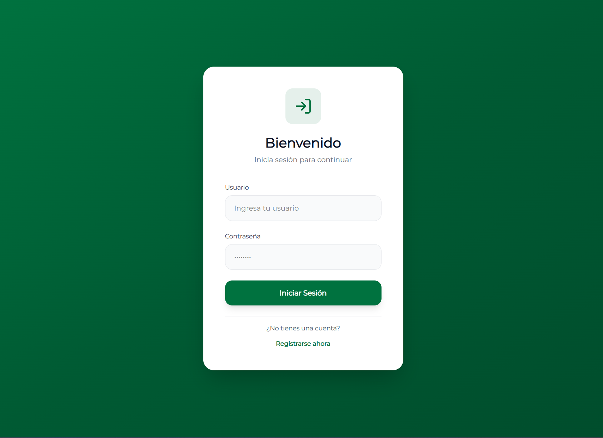
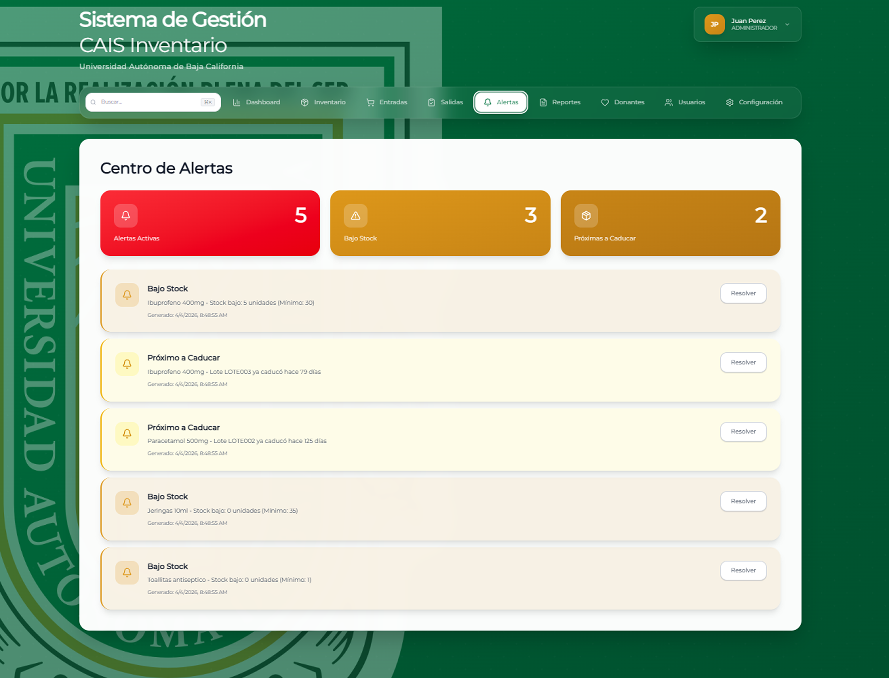
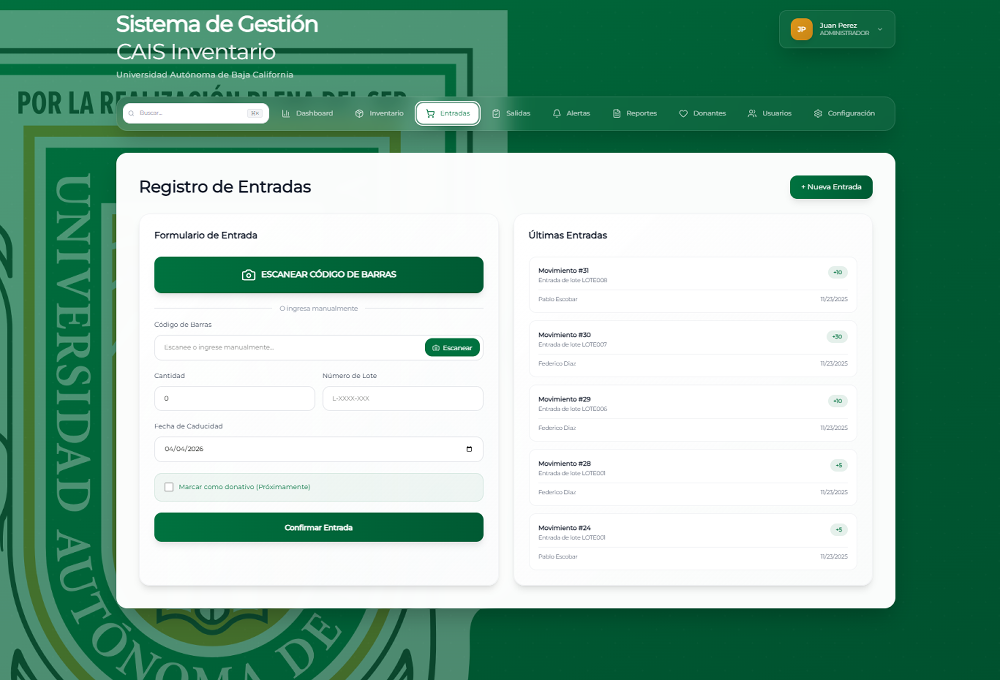
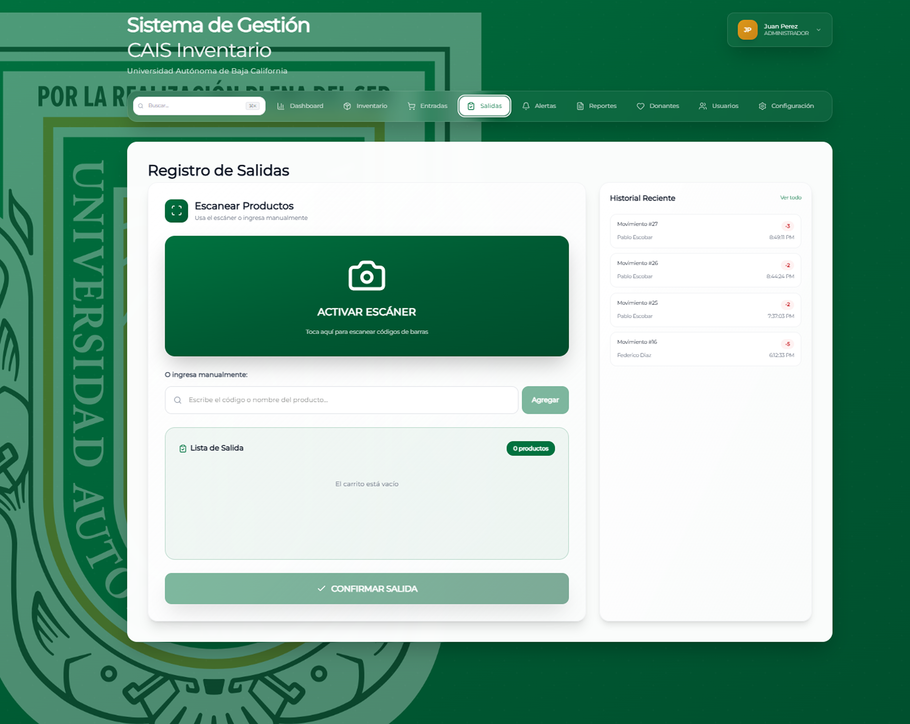
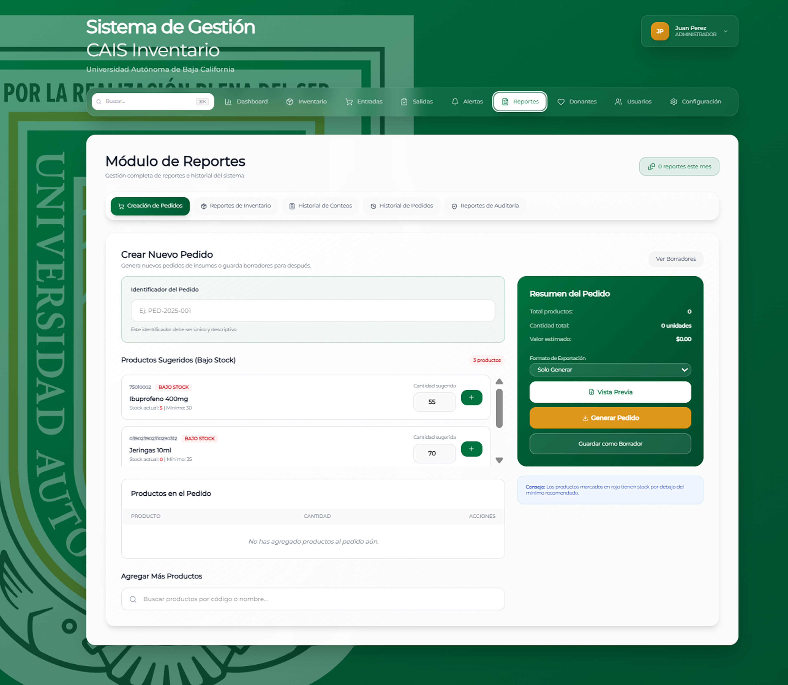

# CAIS Inventario

### Inventario claro para una operación que no puede detenerse

Sistema web de gestión de insumos para el Centro de Atención Integral de Salud de la UABC. Reúne inventario, entradas, salidas, alertas y reportes en flujos por rol.

**Periodo documentado:** 2025–2026  
**Estado:** Entregable académico desarrollado en equipo  
**Tecnologías:** React · TypeScript · Vite · Supabase

## Qué hace

- Paneles diferenciados para administración, inventario y personal consumidor.
- Registro de entradas y salidas con apoyo de códigos de barras.
- Alertas de existencias y caducidad, conteo físico y reportes.

## Vista del proyecto

Pantallas del entregable y maquetas de 2025–2026. Los nombres y registros visibles en las maquetas son datos de ejemplo.

### Pantalla de acceso a CAIS Inventario

### Centro de alertas de inventario

### Maqueta del registro de entradas

### Maqueta del registro de salidas

### Maqueta del módulo de reportes

## Contexto

Proyecto para CAIS UABC. Presentación de un trabajo de equipo; el repositorio con código e historial permanece privado.

Esta vitrina contiene únicamente texto e imágenes seleccionadas para presentación. El código fuente, los datos y el historial del proyecto no se publican aquí.

[Ver la ficha visual de CAIS Inventario](https://alfredoae2578.github.io/projects/cais-inventario-presentacion.html)

[Ver todos los proyectos](https://alfredoae2578.github.io/)
